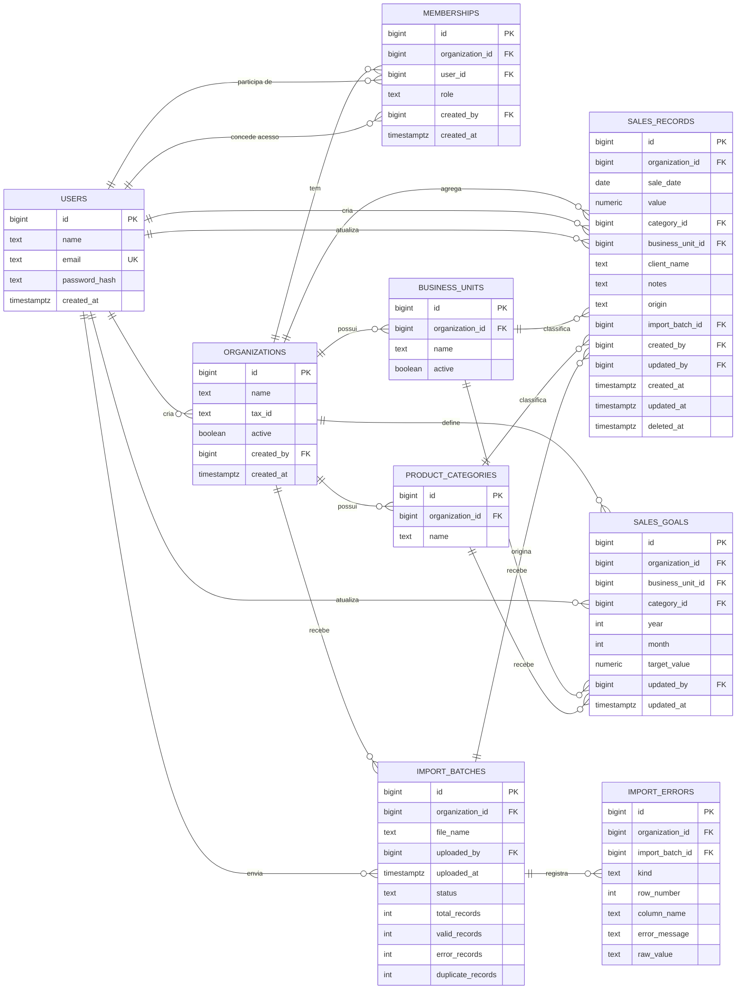

# Modelo de dados

Schema relacional (PostgreSQL, ver [ADR-0004](../adr/0004-banco-dados-postgresql.md)) derivado das telas do protótipo (`docs/prototype/index.html`) e das decisões já tomadas — não é uma proposta especulativa, é o que essas telas precisam para funcionar. Para a visão geral da arquitetura, ver [overview.md](./overview.md).

Nomes de tabela e coluna em inglês (`snake_case`), seguindo a convenção usual de SQLAlchemy/Postgres — o conteúdo do produto (rótulos de tela, categorias, unidades) continua em português.

Diagrama renderizado: [data-model.svg](./data-model.svg) (fonte: [data-model.dot](./data-model.dot), Graphviz).

---

## A regra que atravessa o schema inteiro

**Toda tabela de negócio tem `organization_id`, e toda consulta filtra por ele.** A empresa ativa vem da sessão ([ADR-0006](../adr/0006-autenticacao-jwt-fastapi.md)), nunca de parâmetro enviado pelo cliente. Ver [ADR-0014](../adr/0014-escopo-por-empresa-organizations.md) para o porquê e para o gatilho de quando isso precisará virar Row-Level Security.

Duas consequências práticas:

- `organization_id` existe mesmo onde poderia ser derivado por FK (`import_errors` chegaria nele via `import_batches`). A redundância é deliberada: é essa coluna que uma política de RLS consegue usar diretamente.
- **Constraints únicas que seriam globais passam a ser por empresa.** Duas empresas podem ter, cada uma, uma unidade chamada "Loja Centro". A única exceção é `users.email`: a conta é da pessoa, não da empresa.

---

## Diagrama



---

## Tabelas

### `organizations` (empresas)

A camada de escopo de todo o sistema ([ADR-0014](../adr/0014-escopo-por-empresa-organizations.md)). É o que a tela **Suas empresas** lista e o que o modal **Cadastrar empresa** cria.

| Coluna | Tipo | Constraints | Notas |
|---|---|---|---|
| `id` | `bigserial` | PK | |
| `name` | `text` | not null | ex: "Grupo Vértice" |
| `tax_id` | `text` | null | CNPJ; opcional no cadastro |
| `active` | `boolean` | not null, default `true` | empresa inativa some do seletor mas preserva os dados |
| `created_by` | `bigint` | FK → `users.id`, not null | quem criou vira Admin dela automaticamente |
| `created_at` | `timestamptz` | not null, default `now()` | |

`name` **não** é único: duas empresas de clientes diferentes podem se chamar igual.

### `users` (contas)

A conta é da pessoa e existe independentemente de qualquer empresa — é criada na tela **Criar conta** e só depois vinculada. Autenticação e autorização vivem inteiramente na FastAPI ([ADR-0006](../adr/0006-autenticacao-jwt-fastapi.md)).

| Coluna | Tipo | Constraints | Notas |
|---|---|---|---|
| `id` | `bigserial` | PK | |
| `name` | `text` | not null | |
| `email` | `text` | **unique global**, not null | é a chave usada para vincular alguém a uma empresa |
| `password_hash` | `text` | not null | bcrypt, gerado e verificado pela API (passlib) |
| `created_at` | `timestamptz` | not null, default `now()` | |

**Não há mais coluna `role` aqui.** O papel depende da empresa e mora em `memberships`.

### `memberships` (vínculo pessoa ↔ empresa)

O coração do modelo de acesso: é o que a tela **Usuários da empresa** lista e edita, e o que a tela **Suas empresas** consulta para montar os cards com o papel de cada uma.

| Coluna | Tipo | Constraints | Notas |
|---|---|---|---|
| `id` | `bigserial` | PK | |
| `organization_id` | `bigint` | FK → `organizations.id`, not null | |
| `user_id` | `bigint` | FK → `users.id`, not null | |
| `role` | `text` | not null, check in `('admin','usuario')` | ver [ADR-0009](../adr/0009-rbac-dois-perfis.md) |
| `created_by` | `bigint` | FK → `users.id`, not null | quem concedeu o acesso |
| `created_at` | `timestamptz` | not null, default `now()` | a coluna "Desde" da tela |

**Constraint única:** `(organization_id, user_id)` — uma pessoa tem no máximo um papel por empresa.
**Índice adicional:** `(user_id)` — usado a cada login para montar a lista de empresas.

Regra de negócio que o schema **não** consegue expressar e precisa ser garantida na API: uma empresa nunca pode ficar sem nenhum `role = 'admin'`.

### `business_units` (unidades de negócio)

Tabela de apoio em vez de enum fixo — permite abrir ou fechar uma unidade sem deploy. Alimenta o KPI "Unidades ativas" e os filtros de Registros, Metas e Painel.

| Coluna | Tipo | Constraints | Notas |
|---|---|---|---|
| `id` | `bigserial` | PK | |
| `organization_id` | `bigint` | FK → `organizations.id`, not null | |
| `name` | `text` | not null | ex: "Loja Centro" |
| `active` | `boolean` | not null, default `true` | unidade inativa some dos filtros de novo lançamento mas mantém histórico |

**Constraint única:** `(organization_id, name)`.

### `product_categories` (categorias de produto)

Mesma lógica de `business_units`: tabela de apoio editável, não enum.

| Coluna | Tipo | Constraints | Notas |
|---|---|---|---|
| `id` | `bigserial` | PK | |
| `organization_id` | `bigint` | FK → `organizations.id`, not null | |
| `name` | `text` | not null | ex: "Eletrônicos" |

**Constraint única:** `(organization_id, name)`.

### `import_batches` (histórico de importações)

Uma linha por upload — é o que a tela **Histórico** lista e o que a tela **Ingestão** cria.

| Coluna | Tipo | Constraints | Notas |
|---|---|---|---|
| `id` | `bigserial` | PK | |
| `organization_id` | `bigint` | FK → `organizations.id`, not null | |
| `file_name` | `text` | not null | o arquivo em si não é guardado ([ADR-0010](../adr/0010-sem-storage-arquivo-bruto.md)) |
| `uploaded_by` | `bigint` | FK → `users.id`, not null | |
| `uploaded_at` | `timestamptz` | not null, default `now()` | |
| `status` | `text` | not null, check in `('processing','completed','completed_with_errors','failed')` | |
| `total_records` | `int` | not null | |
| `valid_records` | `int` | not null | |
| `error_records` | `int` | not null, default 0 | |
| `duplicate_records` | `int` | not null, default 0 | |

**Índice:** `(organization_id, uploaded_at desc)` — a ordenação da tela Histórico e o KPI de taxa de erro por período.

**Sobre `status`:**

- `processing` é o estado enquanto a `BackgroundTask` roda ([ADR-0007](../adr/0007-processamento-assincrono-backgroundtasks.md)); é o campo que a tela de Ingestão consulta por polling. Como o processamento roda no mesmo processo da API, um restart deixa batches presos nesse estado: **na subida, a API marca como `failed` todo batch em `processing` há mais de 15 minutos.**
- **"Duplicados" não é um status.** O filtro homônimo da tela Histórico é `duplicate_records > 0`, e o chip convive com `completed` ou `completed_with_errors`. Quando um batch tem erro e duplicata ao mesmo tempo, a UI mostra o pior caso primeiro (erro).
- `error_records` e `duplicate_records` são derivados das linhas de `import_errors` e existem denormalizados para a tela Histórico não precisar agregar a cada carga.

### `import_errors` (linhas não importadas)

Apesar do nome, guarda **toda linha rejeitada** — erro de formato e duplicata. Alimenta a lista "Linhas não importadas" da tela de Ingestão e o "ver detalhes" do Histórico.

| Coluna | Tipo | Constraints | Notas |
|---|---|---|---|
| `id` | `bigserial` | PK | |
| `organization_id` | `bigint` | FK → `organizations.id`, not null | |
| `import_batch_id` | `bigint` | FK → `import_batches.id`, not null, `on delete cascade` | |
| `kind` | `text` | not null, check in `('error','duplicate')` | |
| `row_number` | `int` | not null | linha na planilha original |
| `column_name` | `text` | null | a coluna culpada; nulo quando `kind = 'duplicate'` (a linha inteira é a duplicata) |
| `error_message` | `text` | not null | texto exibido na tela |
| `raw_value` | `text` | null | valor bruto que causou o erro, quando aplicável |

Sem essa tabela cobrindo duplicatas, a promessa da tela de Ingestão — *"os 15 restantes ficam disponíveis no histórico para revisão"* — não teria como ser cumprida: haveria apenas um contador, sem saber quais linhas foram.

### `sales_records` (Registros — dados centralizados)

Tabela central: é o que a tela **Registros** lista, o que **Cadastro manual** insere, o que **Ingestão** popula em massa e o que os gráficos do **Painel geral** agregam.

| Coluna | Tipo | Constraints | Notas |
|---|---|---|---|
| `id` | `bigserial` | PK | |
| `organization_id` | `bigint` | FK → `organizations.id`, not null | |
| `sale_date` | `date` | not null | |
| `value` | `numeric(12,2)` | not null | **nunca `float`** — dinheiro é sempre `numeric` para evitar erro de arredondamento |
| `category_id` | `bigint` | FK → `product_categories.id`, not null | |
| `business_unit_id` | `bigint` | FK → `business_units.id`, not null | |
| `client_name` | `text` | null | texto livre no v1; "nome ou razão social" na tela |
| `notes` | `text` | null | o campo "Observações" do Cadastro manual |
| `origin` | `text` | not null, check in `('import','manual')` | os chips "Importado"/"Manual" |
| `import_batch_id` | `bigint` | FK → `import_batches.id`, null | preenchido só quando `origin = 'import'` |
| `created_by` | `bigint` | FK → `users.id`, not null | |
| `updated_by` | `bigint` | FK → `users.id`, null | preenchido na edição |
| `created_at` | `timestamptz` | not null, default `now()` | |
| `updated_at` | `timestamptz` | not null, default `now()` | |
| `deleted_at` | `timestamptz` | null | exclusão lógica — ver abaixo |

**Índices:** `(organization_id, sale_date)` e `(organization_id, business_unit_id, category_id)`, ambos parciais `where deleted_at is null` — são exatamente os agrupamentos que os gráficos do Painel geral fazem.

**Edição e exclusão.** A tela Registros tem botões de editar e excluir por linha, visíveis apenas para Admin. A exclusão é **lógica** (`deleted_at`), não física: apagar de verdade tornaria os totais históricos irreproduzíveis e impediria qualquer investigação de "esse número mudou, por quê?". Toda consulta de negócio precisa incluir `deleted_at is null` — é a segunda cláusula que não pode ser esquecida, junto do `organization_id`. Motivo a mais para as consultas viverem numa camada de repositório.

`created_by`/`updated_by`/`updated_at` cobrem "quem criou, quem mudou por último e quando" — não um histórico campo a campo (ver "Fora de escopo").

### `sales_goals` (Metas)

Uma linha por combinação unidade × categoria × ano × mês — é a grade editável da tela **Metas**.

| Coluna | Tipo | Constraints | Notas |
|---|---|---|---|
| `id` | `bigserial` | PK | |
| `organization_id` | `bigint` | FK → `organizations.id`, not null | |
| `business_unit_id` | `bigint` | FK → `business_units.id`, not null | |
| `category_id` | `bigint` | FK → `product_categories.id`, not null | |
| `year` | `int` | not null | |
| `month` | `int` | not null, check entre 1 e 12 | |
| `target_value` | `numeric(12,2)` | not null | mesmo motivo do `numeric` em `sales_records.value` |
| `updated_by` | `bigint` | FK → `users.id`, not null | |
| `updated_at` | `timestamptz` | not null, default `now()` | |

**Constraint única:** `(organization_id, business_unit_id, category_id, year, month)` — é o que garante que "Salvar metas" faça upsert em vez de duplicar linhas.

**Meta ausente conta como zero.** No gráfico "real vs. meta" do Painel com "Todas as unidades" selecionado, as metas somam; uma unidade sem meta lançada entra como zero, o que faz a linha de meta parecer menor do que a intenção real. A tela avisa quantas unidades estão sem meta no ano — sem esse aviso, o gráfico mente em silêncio.

---

## Regra de duplicata

Pendência fechada. Uma linha da planilha é **duplicata** quando já existe, na mesma empresa e não excluída, um registro com a mesma chave natural:

```
(organization_id, sale_date, value, business_unit_id, category_id, coalesce(client_name, ''))
```

- A comparação é **contra o que já está no banco**, não contra outras linhas do mesmo arquivo — é o que a tela quer dizer com "duplicados existentes". Linhas repetidas dentro do próprio arquivo caem na mesma regra por consequência: a primeira entra, a segunda encontra a primeira já gravada.
- Duplicata **não é importada**. Vira linha em `import_errors` com `kind = 'duplicate'` e incrementa `duplicate_records`.
- Cadastro manual **não** aplica a regra: se a pessoa digitou, ela quis. Duas vendas idênticas no mesmo dia são um evento possível.
- Não há constraint única no banco para isso, deliberadamente — a regra vale para importação, não para todo insert, e o cadastro manual precisa poder violá-la.

## Unidade ou categoria inexistente na importação

Pendência fechada. Quando a planilha traz uma unidade ou categoria que não existe naquela empresa, **a linha é rejeitada** (`kind = 'error'`) — a importação não cria unidade nem categoria automaticamente. É o comportamento que o protótipo já exibe (`"Loja Norte" não corresponde a nenhuma unidade cadastrada`).

O motivo: criar cadastros a partir de planilha é como uma base vira lixo. Um erro de digitação viraria uma unidade nova, e o filtro do dashboard passaria a listar "Loja Cetro" ao lado de "Loja Centro".

---

## Como isso mapeia para as telas

| Tela | Tabelas envolvidas |
|---|---|
| Entrar / Criar conta | `users` |
| Suas empresas | `memberships` + `organizations` |
| Cadastrar empresa | `insert` em `organizations` + `memberships` (criador como `admin`) |
| Usuários da empresa | `memberships` + `users` |
| Painel geral | `sales_records` agregado · `sales_goals` (série "Meta") · `import_batches` (KPI de importação) |
| Registros | `sales_records` + join em `business_units` e `product_categories` |
| Metas | `sales_goals` + join nas duas dimensões |
| Cadastro manual | `insert` em `sales_records` com `origin = 'manual'`, `import_batch_id = null` |
| Ingestão | `insert` em `import_batches`, `import_errors` e `sales_records` (`origin = 'import'`) |
| Histórico | `import_batches` + `import_errors` no "ver detalhes" |

---

## Fora de escopo por ora

- **Clientes normalizados** — `client_name` é texto livre. Uma tabela `clients` com CNPJ/CPF e contato é natural depois, mas nenhuma tela precisa disso ainda. **Atenção de LGPD:** esse campo pode conter nome de pessoa física.
- **Trilha de auditoria completa** — o schema registra quem criou e quem alterou por último, não um histórico campo a campo. Se a funcionalidade for confirmada com o cliente, vira uma tabela `audit_log` separada.
- **Telas de CRUD de unidades e categorias** — o schema suporta criar e desativar sem deploy, mas nenhuma tela gerencia isso ainda; no piloto são seed data por empresa.
- **Persistência do mapeamento de colunas** — a tela de Ingestão mapeia colunas a cada upload e não guarda o mapeamento. Funciona, mas o usuário remapeia toda vez. Primeira melhoria provável do módulo.
- **Row-Level Security** — ver o gatilho no [ADR-0014](../adr/0014-escopo-por-empresa-organizations.md).
- **Camada de definição de métrica** — onde vive a definição única de "receita", para que Painel e exportação nunca divirjam. Continua em aberto; ver [overview.md](./overview.md#pontos-em-aberto).

Migrations são feitas com Alembic, decidido no [ADR-0004](../adr/0004-banco-dados-postgresql.md).
